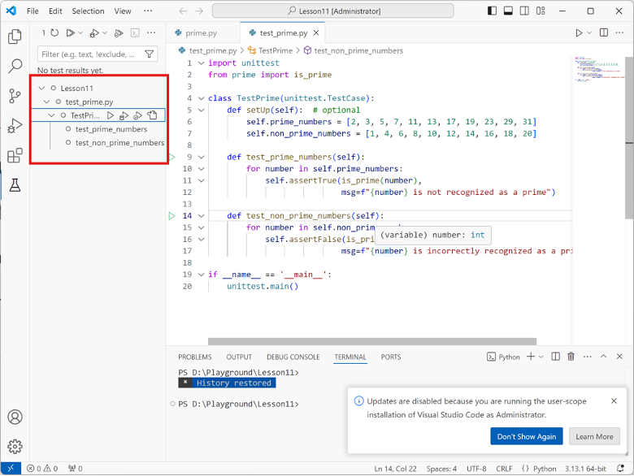
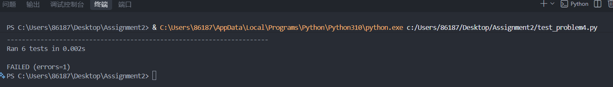
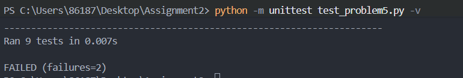

问题/错误报告 Bug Report

该报告记录了在有错误程序中发现的问题（bugs），包括失败的测试用例、根本原因分析（root cause analysis）以及已应用的修复方案。

---

## 问题/错误报告 1：（示例）

- 1. 测试程序 Program Under Test
- **File:** `problemX.py`
- **Class / Function:** `YourClassName.method_name()`

### 2. 失败的测试用例 Failing Test Case

提供来自 `test_problemX.py` 的单元测试代码，用于暴露该缺问题/错误并在执行过程中失败：

```python
# 在此粘贴失败的测试方法
def test_example_failure(self):
    pass
```

提供从 VS Code 中捕获的测试运行结果。



**测试输出 / 错误信息：**

```text
# 在此粘贴错误追踪 / 断言失败信息（error traceback / assertion failure message）
```

### 3. 根本原因分析 Root Cause Analysis

说明该问题/错误（bug）为何会发生，以及它导致了什么错误行为：

- **预期行为：**（根据规范应发生什么）
- **实际行为：**（起始代码中实际发生了什么）
- **根本原因：**（对代码逻辑中问题/错误的解释）

### 4. 代码修复与差异 Code Fix & Diff

展示对 `problemX.py` 进行修复所做的修改：

```diff
- # Original buggy code line
+ # Corrected code line
```

---

# 问题/错误报告 `4：MeetingRoom 相邻预订冲突`

1. `problem4.py`
2. `Class / Function`:`MeetingRoom.book()`

## 2. 失败的测试用例 Failing Test Case

```
def test_back_to_back_meetings_allowed(self):
    self.room.book("B01", "Morning Meeting", 9, 10, 5)
    self.room.book("B02", "Second Meeting", 10, 12, 4)
```

## 3. 根本原因分析 Root Cause Analysis



* 预期行为 ：根据预定规则，首尾相接的回忆不冲突
* 实际行为：第二场与第一场有冲突
* 根本原因：使用的<与>，只有两个时间段存在间隔才行

## 4.代码修复与差异 Code Fix & Diff

将problem4.py 的 `if not (end_time < b["start_time"] or start_time > b["end_time"]):` 改为  `if not (end_time <= b["start_time"] or start_time >= b["end_time"]):`


# 问题/错误报告 5：`最小值和最大值聚合实现写反`/`空列表未触发异常及列表类型检查缺失`

1. `problem5.py`
2. `Class / Function`:`problem5.py`/`clean_and_aggregate()` 

## 2.失败的测试用例 Failing Test Case

`test_problem5.py`中`test_aggregate_min_and_max`的

```python
 def test_aggregate_min_and_max(self):
        """
        测试最小值和最大值聚合操作。
        """
        min_result = clean_and_aggregate(self.sample_sales, group_by="region", metric="sales", aggregation="min")
        max_result = clean_and_aggregate(self.sample_sales, group_by="region", metric="sales", aggregation="max")

        self.assertAlmostEqual(min_result["North"], 100.0)
        self.assertAlmostEqual(max_result["North"], 200.0)
        self.assertAlmostEqual(min_result["South"], 150.0)
        self.assertAlmostEqual(max_result["South"], 350.0)
```

North组的销售额为 100.0和200.0 ，但原始程序返回最小值为 200.0

```python
 def test_empty_dataset_raises_value_error(self):
        """
        测试传入空列表时抛出 ValueError。
        """
        with self.assertRaises(ValueError):
            clean_and_aggregate([], group_by="region", metric="sales")
```

## 3. 根本原因分析 Root Cause Analysis



3.1最小值和最大值聚合实现

* 预期行为 ：min返回组内最小值，max返回组内最大值
* 实际行为：min返回组内最大值，max返回组内最小值
* 根本原因：连个函数写反

3.2空列表未触发异常及列表类型检查缺失

* 预期行为 ：输入空列表时抛出ValueError  输入不是列表时抛出 TypeError

* 实际行为：`输入空列表时，循环没有执行，函数直接返回空字`
* 根本原因：``函数入口缺少对 `records` 类型和空列表的检查``

## 4.代码修复与差异 Code Fix & Diff


```python
def clean_and_aggregate(
    records: List[Dict[str, Any]],
    group_by: str,
    metric: str,
    aggregation: str = "mean",
    filter_fn: Optional[Callable[[Dict[str, Any]], bool]] = None
) -> Dict[str, float]:
    """按指定键对记录进行过滤、清洗和聚合。"""

    # 检查输入类型和空列表。
    if not isinstance(records, list):
        raise TypeError("records must be a list")

    if not records:
        raise ValueError("records cannot be empty")

    valid_aggregations = {"sum", "mean", "min", "max", "count"}
    agg_op = aggregation.lower()

    if agg_op not in valid_aggregations:
        raise ValueError(
            f"Invalid aggregation '{aggregation}'. "
            f"Must be one of {valid_aggregations}"
        )

    grouped_values: Dict[str, List[float]] = {}

    for i, record in enumerate(records):
        if not isinstance(record, dict):
            raise TypeError(
                f"Record at index {i} must be a dictionary"
            )

        if group_by not in record:
            raise ValueError(
                f"Record at index {i} is missing group_by key: "
                f"'{group_by}'"
            )

        if metric not in record:
            raise ValueError(
                f"Record at index {i} is missing metric key: "
                f"'{metric}'"
            )

        if filter_fn is not None and not filter_fn(record):
            continue

        raw_val = record[metric]

        # 忽略指标值为 None 的记录。
        if raw_val is None:
            continue

        # bool 虽然是 int 的子类，但这里不作为有效数值。
        if not isinstance(raw_val, (int, float)) or isinstance(raw_val, bool):
            raise TypeError(
                f"Metric value '{raw_val}' in record {i} is not numeric"
            )

        group_key = str(record[group_by])
        if group_key not in grouped_values:
            grouped_values[group_key] = []

        grouped_values[group_key].append(float(raw_val))

    results: Dict[str, float] = {}

    for group_key, values in grouped_values.items():
        if agg_op == "sum":
            val = sum(values)
        elif agg_op == "mean":
            val = sum(values) / len(values)
        elif agg_op == "min":
            val = min(values)
        elif agg_op == "max":
            val = max(values)
        else:  # count
            val = float(len(values))

        results[group_key] = round(val, 2)
```
